  

<h1 align="center">Kholofelo “Robyn” Rababalela</h1>

  <strong>Architect · Research Builder · Believer</strong> 
  Founder Director @ Kopano Labs · CPUT student · Cape Town, South Africa 🇿🇦

  
  
  
  
  

  ✝️ <strong>Jesus is King.</strong> 
  <em>I want the things I build to serve people before they impress people.</em>

  

---

## 👋 Hi — I’m Robyn

I build software, AI systems, games, governance protocols, financial agents, robotics experiments and strange little research machines from Cape Town.

But the thread underneath all of it is becoming clearer:

> **How do we give intelligent systems more capability without giving up human authority, identity, accountability, memory or truth?**

I started by building applications. Then I became obsessed with what happens when software **remembers**, **acts**, **coordinates**, **changes the world**, and has to explain why it did so.

That is where most of my work lives now.

I care about people who do not have perfect infrastructure, perfect bandwidth, perfect devices, perfect credentials or time to decode a complicated interface. South African realities — unemployment, transport cost, township infrastructure, education, small business, safety and opportunity — are not “edge cases” in my work. They are design inputs.

---
